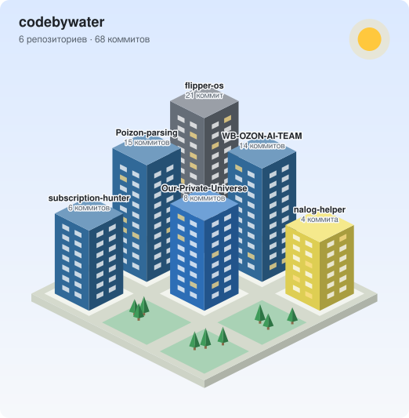

# 🏙 GitHub City

[](https://github.com/codebywater/github-city/actions/workflows/tests.yml)


**Изометрический город из ваших репозиториев для README профиля.** Каждый репозиторий — дом: высота зависит от числа коммитов, цвет — от языка. Днём светит солнце, ночью горят окна и мерцают звёзды: картинка сама подстраивается под светлую или тёмную тему GitHub.

<picture>
  <source media="(prefers-color-scheme: dark)" srcset="assets/city-dark.svg">
  
</picture>

> **English summary.** Turns your public repositories into an isometric SVG city for your GitHub profile README: building height grows with the number of commits, color = main language, light and dark versions. A GitHub Action redraws it daily. Zero dependencies.

## Как добавить в профиль

1. В репозитории профиля (`ваш-ник/ваш-ник`) создайте файл `.github/workflows/city.yml`:

   ```yaml
   name: GitHub City
   on:
     schedule:
       - cron: "0 3 * * *"   # каждый день в 03:00 UTC
     workflow_dispatch:
   permissions:
     contents: write
   concurrency:              # ручной запуск и запуск по расписанию не толкаются друг с другом
     group: github-city
     cancel-in-progress: false
   jobs:
     city:
       runs-on: ubuntu-latest
       steps:
         - uses: actions/checkout@v5
         - uses: codebywater/github-city@v1
   ```

2. Запустите его вручную: **Actions → GitHub City → Run workflow**. В репозитории появятся `assets/city-light.svg` и `assets/city-dark.svg`.

3. Добавьте в README профиля:

   ```html
   <picture>
     <source media="(prefers-color-scheme: dark)" srcset="assets/city-dark.svg">
     
   </picture>
   ```

Дальше город будет перестраиваться каждый день: новые репозитории — новые дома, а высота домов меняется вслед за числом коммитов.

> **Расписание и 60 дней тишины.** GitHub [отключает](https://docs.github.com/en/actions/writing-workflows/choosing-when-your-workflow-runs/events-that-trigger-workflows#schedule) запуск по расписанию в публичном репозитории, если в нём 60 дней не было активности. Action коммитит только когда город изменился, поэтому после долгого перерыва в коммитах расписание может отключиться. Как этого избежать:
>
> - любой коммит в репозиторий профиля (например, правка README) сбрасывает счётчик;
> - начиная с 50-го дня без коммитов action пишет предупреждение в лог запуска;
> - если расписание уже отключено, включите его: **Actions → GitHub City → Enable workflow**, затем **Run workflow**. Сам по себе новый коммит отключённое расписание не включает.

## Настройки

| Параметр | По умолчанию | Что делает |
|---|---|---|
| `user` | владелец репозитория | Чей город рисовать |
| `out` | `assets` | Папка для картинок |
| `exclude` | — | Скрыть репозитории: `dotfiles,test-repo` |
| `forks` | `false` | Показывать форки |
| `max-repos` | `36` | Сколько домов рисовать (самые большие по коммитам), `0` — все |
| `commit` | `true` | Коммитить картинки, если изменились |
| `token` | `${{ github.token }}` | Токен для GitHub API |

```yaml
- uses: codebywater/github-city@v1
  with:
    exclude: dotfiles,playground
```

## Как это устроено

- Берутся ваши публичные репозитории, кроме форков, пустых, репозитория профиля и репозитория, в котором работает action (туда коммитится картинка, и его счётчик коммитов растёт от самого action).
- Число коммитов считается по основной ветке через GitHub API, без клонирования.
- Высота дома растёт как корень из числа коммитов: самый большой проект не задавит остальные.
- Высокие дома ставятся в глубину, низкие — вперёд, чтобы ничего не загораживало. На свободных участках растут деревья.
- Больше 36 домов в колонке README уже не читаются, поэтому рисуются 36 самых больших репозиториев, а в подзаголовке написано, сколько их всего. Слишком длинные имена обрезаются с «…», полное имя видно во всплывающей подсказке.
- Одинаковые данные дают одинаковую картинку, поэтому лишних коммитов «Update GitHub City» не будет. Коммиты самого action не считаются: репозиторий, в котором он работает, в город не попадает. Не считать только коммиты «Update GitHub City» надёжно нельзя — GitHub API не фильтрует коммиты по сообщению.
- Если пока action рисовал город, в ветку что-то запушили, он подтянет изменения и попробует запушить ещё раз (до трёх попыток).

## Запуск на своём компьютере

Нужен Node.js 18+, зависимостей нет.

```bash
git clone https://github.com/codebywater/github-city
cd github-city
node src/cli.js ваш-ник --out preview      # с GITHUB_TOKEN лимит API выше
npm run example                            # город из examples/data.json, без интернета
npm test
```

## Лицензия

MIT
